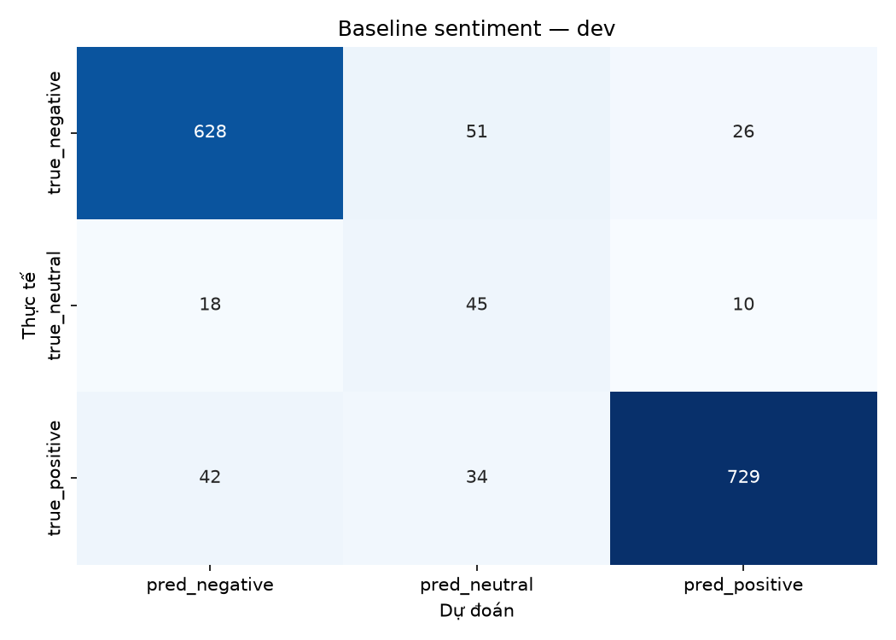
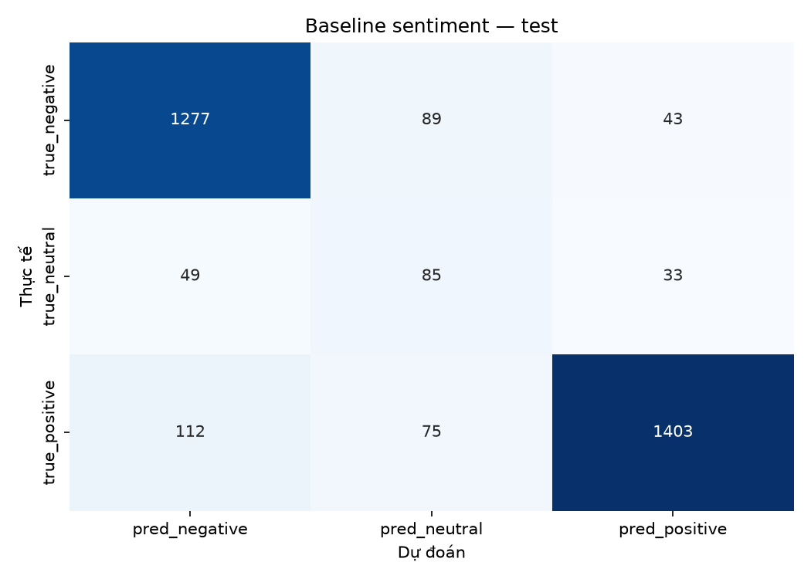
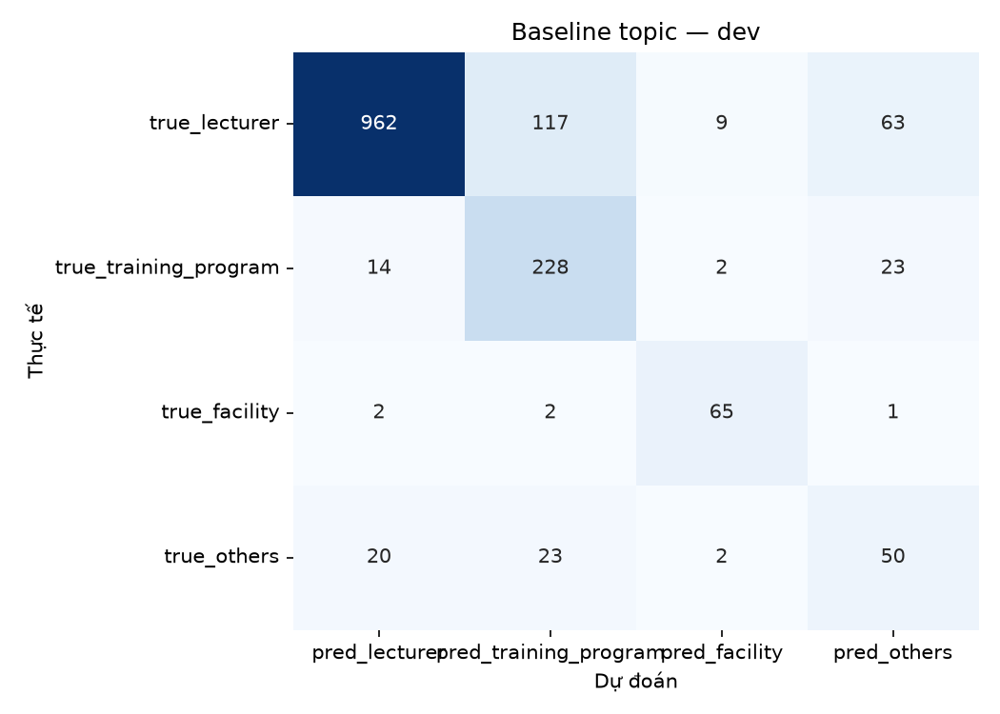

# Baseline — TF-IDF + Logistic Regression

- Run ID: `baseline_tfidf_20261030_162011`
- Seed: `42`
- Vectorizer: word 1–2 grams + char_wb 3–5 grams
- Classifier: Logistic Regression, `class_weight=balanced`
- Model sentiment: `models/baseline/sentiment_tfidf_logreg.joblib`
- Model topic: `models/baseline/topic_tfidf_logreg.joblib`

## Kết quả

| task | split | accuracy | macro_f1 | weighted_f1 |
|---|---|---|---|---|
| sentiment | dev | 0.8857 | 0.7579 | 0.8943 |
| sentiment | test | 0.8733 | 0.74 | 0.88 |
| topic | dev | 0.8244 | 0.7301 | 0.8364 |
| topic | test | 0.8105 | 0.7247 | 0.8261 |
| joint | dev | 0.7454 |  |  |
| joint | test | 0.7227 |  |  |

## Per-class

### Sentiment — dev

| label | precision | recall | f1 | support |
|---|---|---|---|---|
| negative | 0.9128 | 0.8908 | 0.9017 | 705 |
| neutral | 0.3462 | 0.6164 | 0.4433 | 73 |
| positive | 0.9529 | 0.9056 | 0.9287 | 805 |

### Sentiment — test

| label | precision | recall | f1 | support |
|---|---|---|---|---|
| negative | 0.888 | 0.9063 | 0.8971 | 1409 |
| neutral | 0.3414 | 0.509 | 0.4087 | 167 |
| positive | 0.9486 | 0.8824 | 0.9143 | 1590 |

### Topic — dev

| label | precision | recall | f1 | support |
|---|---|---|---|---|
| lecturer | 0.9639 | 0.8358 | 0.8953 | 1151 |
| training_program | 0.6162 | 0.8539 | 0.7159 | 267 |
| facility | 0.8333 | 0.9286 | 0.8784 | 70 |
| others | 0.365 | 0.5263 | 0.431 | 95 |

### Topic — test

| label | precision | recall | f1 | support |
|---|---|---|---|---|
| lecturer | 0.9593 | 0.8227 | 0.8858 | 2290 |
| training_program | 0.5945 | 0.7867 | 0.6772 | 572 |
| facility | 0.8816 | 0.9241 | 0.9024 | 145 |
| others | 0.3345 | 0.6164 | 0.4336 | 159 |

## Confusion matrix

## Nhận xét

- Đây là baseline tuyến tính; chưa dùng tách từ tiếng Việt.
- `neutral` ít mẫu nên cần xem per-class F1, không chỉ accuracy.
- Kết quả này là mốc so sánh cho TextCNN và PhoBERT.
