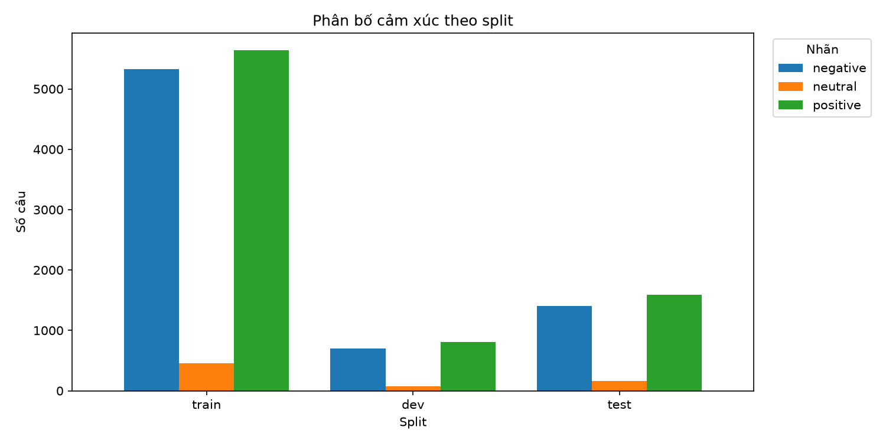
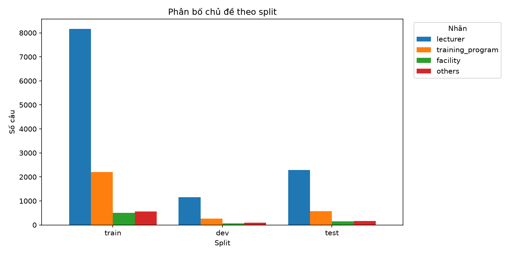
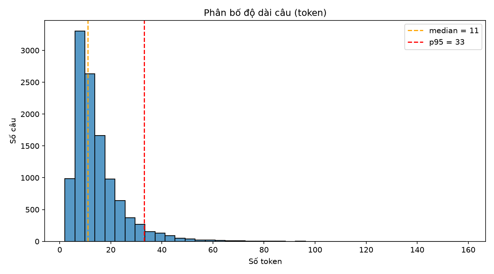
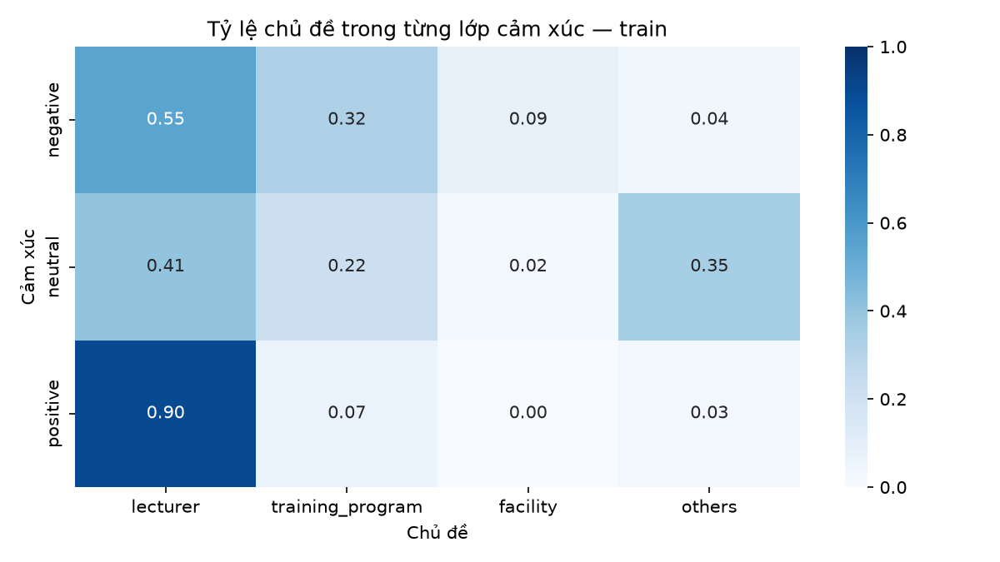
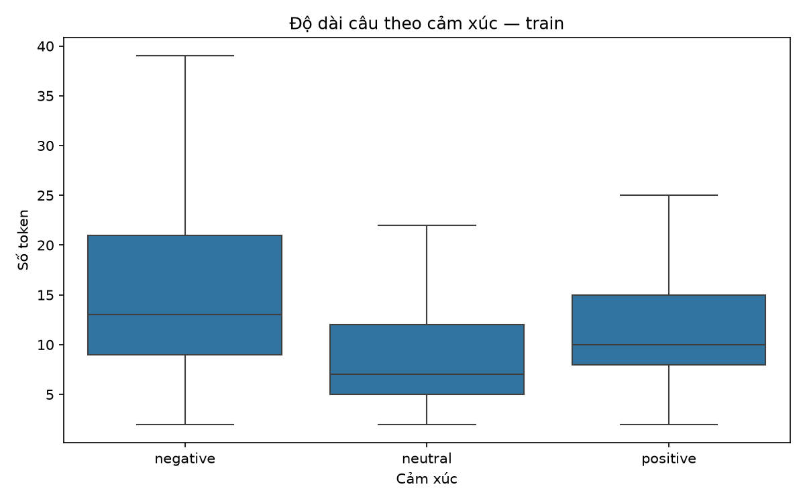

# EDA — UIT-VSFC

Báo cáo được sinh tự động bởi `python -m src.data.eda`.

## 1. Quy mô và phân bố cảm xúc

| split | negative | neutral | positive |
|---|---|---|---|
| train | 5325 | 458 | 5643 |
| dev | 705 | 73 | 805 |
| test | 1409 | 167 | 1590 |

- `neutral` chỉ chiếm **4.0%** câu train.
- Cần dùng **macro-F1** và class weight thay vì chỉ accuracy.

## 2. Phân bố chủ đề

| split | lecturer | training_program | facility | others |
|---|---|---|---|---|
| train | 8166 | 2201 | 497 | 562 |
| dev | 1151 | 267 | 70 | 95 |
| test | 2290 | 572 | 145 | 159 |

- `lecturer` chiếm **71.5%** câu train.
- `facility` và `others` ít hơn đáng kể; cần theo dõi per-class F1.

## 3. Tương quan cảm xúc × chủ đề (train)

### Số lượng

| sentiment | lecturer | training_program | facility | others |
|---|---|---|---|---|
| negative | 2909 | 1716 | 474 | 226 |
| neutral | 186 | 101 | 10 | 161 |
| positive | 5071 | 384 | 13 | 175 |

### Tỷ lệ theo hàng

| sentiment | lecturer | training_program | facility | others |
|---|---|---|---|---|
| negative | 0.546 | 0.322 | 0.089 | 0.042 |
| neutral | 0.406 | 0.221 | 0.022 | 0.352 |
| positive | 0.899 | 0.068 | 0.002 | 0.031 |

- `facility` gần như luôn tiêu cực: **474/497** câu (95.4%), chỉ 13 câu tích cực.
- Phản hồi tích cực tập trung ở `lecturer`: **5071/5643** (89.9%).
- Phản hồi trung tính có tỷ lệ `others` cao: **161/458** (35.2%).
- Sentiment và topic có tương quan mạnh; multi-task có thể học được tín hiệu hữu ích nhưng cũng có nguy cơ học shortcut theo topic.

## 4. Độ dài câu

| split | unit | count | mean | median | p95 | max |
|---|---|---|---|---|---|---|
| train | n_chars | 11426 | 59.08 | 47.0 | 141.0 | 660 |
| train | n_tokens | 11426 | 14.31 | 11.0 | 33.0 | 159 |
| dev | n_chars | 1583 | 56.36 | 45.0 | 132.0 | 718 |
| dev | n_tokens | 1583 | 13.67 | 11.0 | 31.0 | 161 |
| test | n_chars | 3166 | 58.84 | 46.0 | 147.0 | 411 |
| test | n_tokens | 3166 | 14.22 | 11.0 | 34.0 | 98 |
| all | n_chars | 16175 | 58.77 | 46.0 | 141.0 | 718 |
| all | n_tokens | 16175 | 14.23 | 11.0 | 33.0 | 161 |

- p95 số token trên train: **33**.
- Gợi ý `max_len` ban đầu: **48** token.
- Cần kiểm tra lại trên dev trước khi chốt.

### Câu ngắn nhất (train)

| text | n_tokens |
|---|---|
| không ! | 2 |
| chán . | 2 |
| điểm . | 2 |
| nope . | 2 |
| thân . | 2 |

### Câu dài nhất (train)

| text | n_tokens |
|---|---|
| thầy cho nghỉ quá nhiểu mà không sắp xếp giáo viên dạy thay , vì vậy dẫn tới việc học bù liên tiếp vào những ngày cuối , khi mà chúng em phải ôn tập những kiến thức khác , vẫn có một số buổi thông báo học bù nhưng sau đó lại thông báo nghỉ đột đột , dẫn tới bị ùn kiến thức , không ai ăn được một vạ gạo một ngày cả tên môn học là " nhập môn công nghệ phần mềm " nhưng kiến thức và cách đánh giá năng lực học sinh quá nặng nề , nếu là sinh viên các khoa như phần mềm , hệ thống thì có thể hiểu được , nhưng với những sinh viên khoa khoa học máy tính như chúng em vì đây là môn học bắt buộc thì thật là quá sức và những kiến thức thầy nói quá lạc lõng , mơ hồ . | 159 |
| thầy nên hướng dẫn cụ thể về vấn đề đồ án , bọn em lúc làm đồ án không biết làm cái gì và đang làm cái gì , đến khi báo cáo thì tá hỏa lên không biết gì mà làm nữa , thành ra lên báo cáo không có vừa ý thầy , rồi thầy tạo quá nhiều áp lực cho bọn em , thi cử thôi cũng thấy sợ nữa , không biết thầy có thử đặt vị trí của thầy vào bọn em không nữa , 75 câu trắc nghiệm mà một câu có 2 - 3 đáp án đúng nữa có 75 phút , thầy thử nghĩ xem bọn em có nổi 3 - 4 điểm không ? | 123 |
| nội dung học chất lượng nhưng khá đơn giản , thầy sử dụng giờ trên lớp không hiệu quả , chủ yếu thầy vào lớp cho bài tập , giảng một xíu rồi ngồi đó , còn sinh viên giải bài tập tới cuối giờ , dù làm bài tập tới tuần cuối môn học nhưng vẫn không biết kết quả các bài tập mình từng làm là đúng hay sai vì thầy không công bố kết quả để cho thấy được sự sai sót của mình , dẫn đến trước khi thi các sinh viên có sự phân hoá về cách giải bài tập , không thống nhất . | 110 |
| môn học là kiểm chứng phần mềm , nhưng tất cả nội dung giảng dạy chỉ là lý thuyết suông , có chăng là một số phần mềm có thể được sử dụng trong thực tiễn , nhưng sự tìm hiểu chỉ dừng lại ở mức độ " giới thiệu " của cấp độ sinh viên , các bài seminar do sinh viên trình bày hoàn toàn không đạt chất lượng , không truyền đạt được kiến thức , slide hơn 95% là chữ , một số không nhỏ là nội dung dịch từ sách ngoại văn , nhưng lại sai nghĩa , tối nghĩa . | 106 |
| sinh viên rất khó nắm bắt những gì giảng viên viết và ghi chú trên bảng , phần lớn chỉ có thể giảng dạy bằng máy chiếu , dù tốc độ không quá nhanh nhưng cũng chỉ là những dòng chữ lướt qua , khi về nhà lại phải tự mày mò học lại từ đầu tuy nói rằng nhiệm vụ của sinh viên là phải tìm hiểu bài trước khi đến lớp nhưng với việc giảng dạy trong một giảng đường rộng lớn đã khiến vai trò hỗ trợ của giảng viên trở nên mờ nhạt . | 98 |

## 5. Trùng lặp

### Trong từng split

| index | train | dev | test |
|---|---|---|---|
| duplicates | 1 | 0 | 0 |

### Giữa các split

| index | train\|dev | train\|test | dev\|test |
|---|---|---|---|
| overlap | 0 | 0 | 0 |

## 6. Hình

## 7. Kết luận cho bước modeling

1. Dùng split chính thức, không trộn test.
2. Ưu tiên macro-F1 cho cả hai tác vụ.
3. Dùng class weight cho sentiment và topic.
4. Chọn `max_len` theo p95 và kiểm tra lại trên dev.
5. Ghi nhận câu trùng trong train khi làm sạch.
6. Phân tích lỗi theo chủ đề, đặc biệt `facility` và `others`.
7. Kiểm tra truncation: p95 là 33 token nhưng câu dài nhất là 159 token.
8. Cẩn thận với shortcut sentiment–topic khi huấn luyện multi-task.
