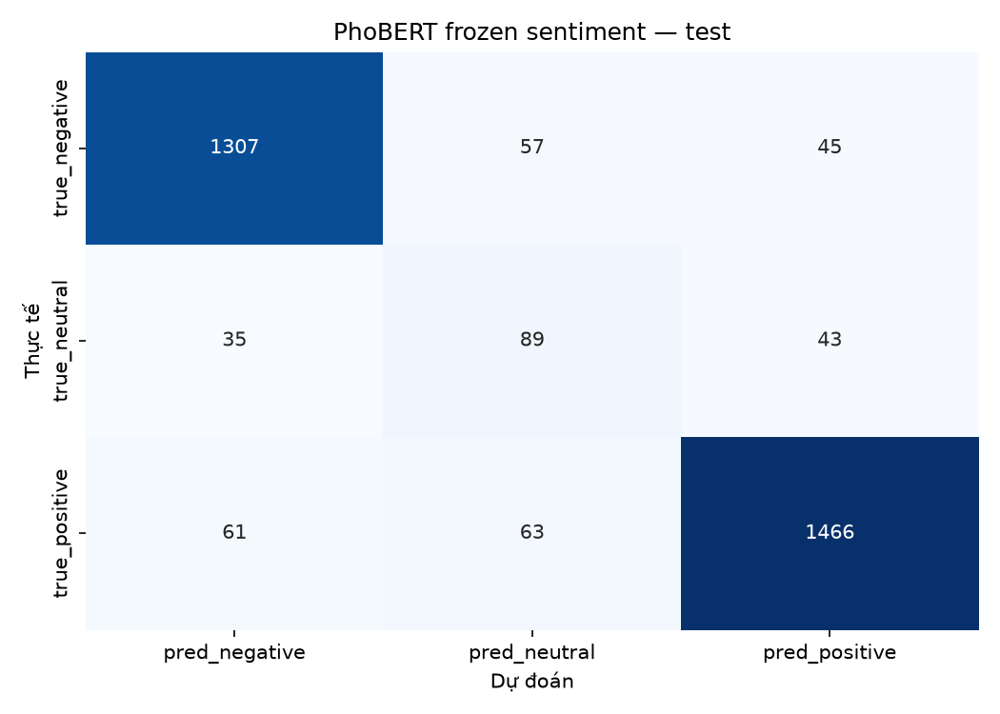
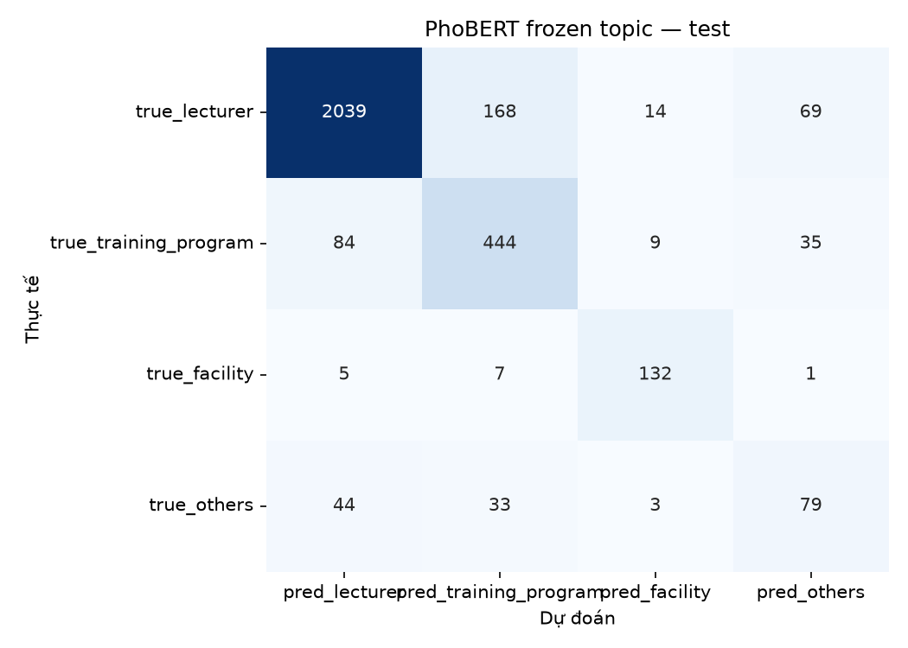
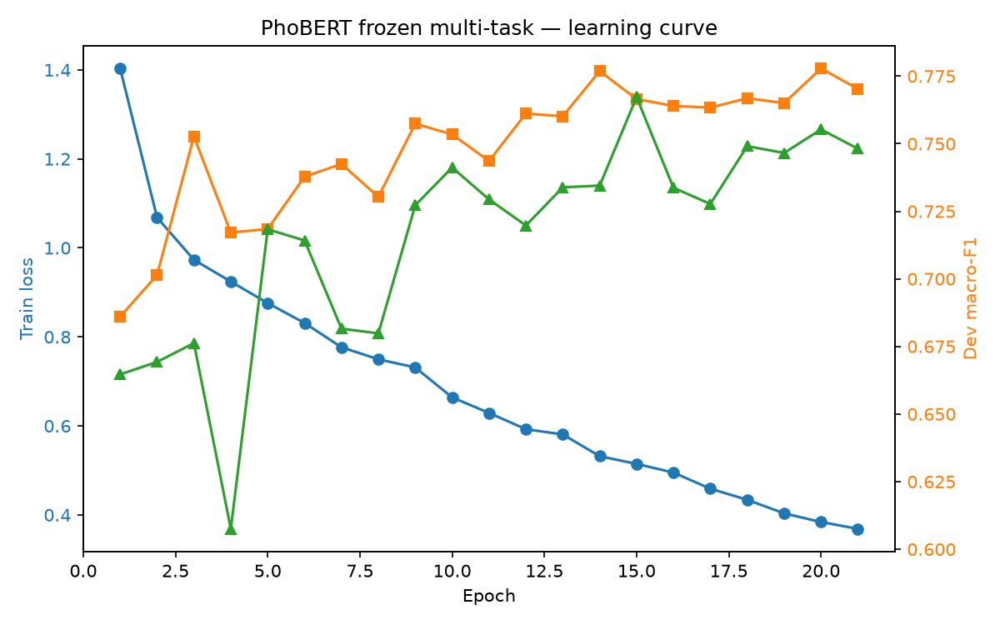

# PhoBERT frozen multi-task — UIT-VSFC

- Run ID: `phobert_multitask_20261030_213231`
- Seed: `42`
- Encoder: `vinai/phobert-base` (frozen)
- Pooling: `[CLS]`
- Lambda topic: `1.0`
- Best epoch: `15`
- Train time: `18.4s`

## Kết quả

| task | split | accuracy | macro_f1 | weighted_f1 |
|---|---|---|---|---|
| sentiment | dev | 0.9109 | 0.7665 | 0.914 |
| sentiment | test | 0.904 | 0.7785 | 0.907 |
| topic | dev | 0.8598 | 0.7673 | 0.8634 |
| topic | test | 0.8509 | 0.7428 | 0.8552 |
| joint | dev | 0.8004 |  |  |
| joint | test | 0.7855 |  |  |

## So sánh test macro-F1

| task | phobert_frozen_multitask | textcnn_multitask | textcnn_single | tfidf_logreg |
|---|---|---|---|---|
| sentiment | 0.7785 | 0.7556 | 0.7621 | 0.74 |
| topic | 0.7428 | 0.739 | 0.7355 | 0.7247 |

So với TextCNN multi-task: sentiment tăng **0.0229**, topic tăng **0.0038**, joint tăng **0.0303**.
So với TextCNN single-task: sentiment tăng **0.0164**, topic tăng **0.0073**, joint tăng **0.0319**.

## sentiment — dev

| label | precision | recall | f1 | support |
|---|---|---|---|---|
| negative | 0.9338 | 0.9404 | 0.9371 | 705 |
| neutral | 0.3804 | 0.4795 | 0.4242 | 73 |
| positive | 0.9526 | 0.9242 | 0.9382 | 805 |

## sentiment — test

| label | precision | recall | f1 | support |
|---|---|---|---|---|
| negative | 0.9316 | 0.9276 | 0.9296 | 1409 |
| neutral | 0.4258 | 0.5329 | 0.4734 | 167 |
| positive | 0.9434 | 0.922 | 0.9326 | 1590 |

## topic — dev

| label | precision | recall | f1 | support |
|---|---|---|---|---|
| lecturer | 0.9426 | 0.8992 | 0.9204 | 1151 |
| training_program | 0.6842 | 0.779 | 0.7285 | 267 |
| facility | 0.8533 | 0.9143 | 0.8828 | 70 |
| others | 0.5094 | 0.5684 | 0.5373 | 95 |

## topic — test

| label | precision | recall | f1 | support |
|---|---|---|---|---|
| lecturer | 0.9388 | 0.8904 | 0.9139 | 2290 |
| training_program | 0.681 | 0.7762 | 0.7255 | 572 |
| facility | 0.8354 | 0.9103 | 0.8713 | 145 |
| others | 0.4293 | 0.4969 | 0.4606 | 159 |

## Learning curve

## Nhận xét

- PhoBERT được đóng băng; chỉ train head phân loại.
- Embedding `[CLS]` được trích một lần và cache trong `data/processed/uit_vsfc_phobert/`.
- Loss: `L_sentiment + lambda * L_topic`.
- Chọn epoch tốt nhất theo trung bình macro-F1 của hai tác vụ trên dev.
