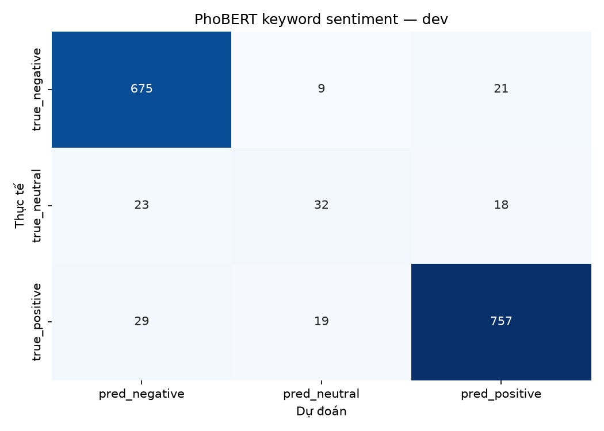
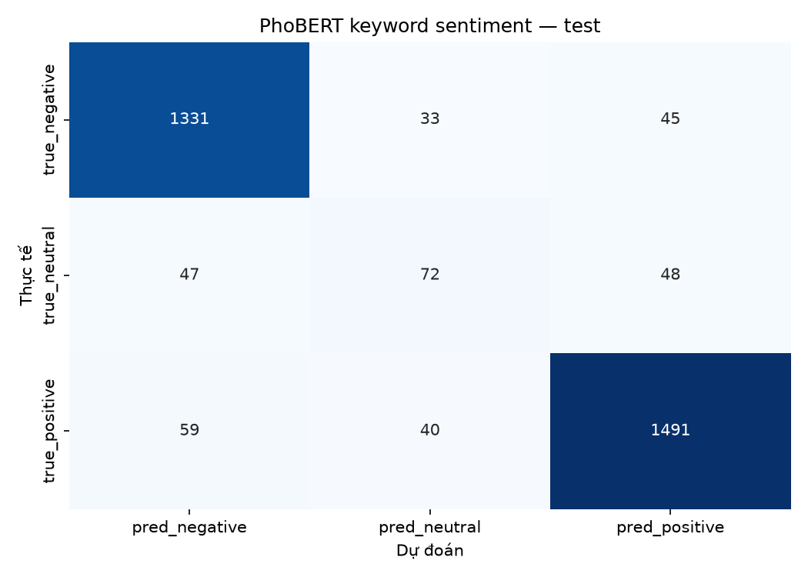
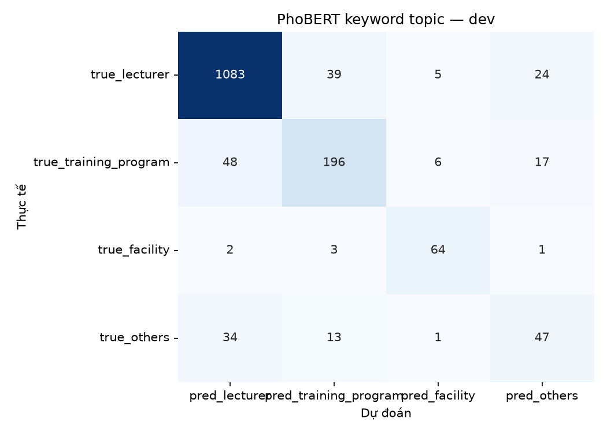
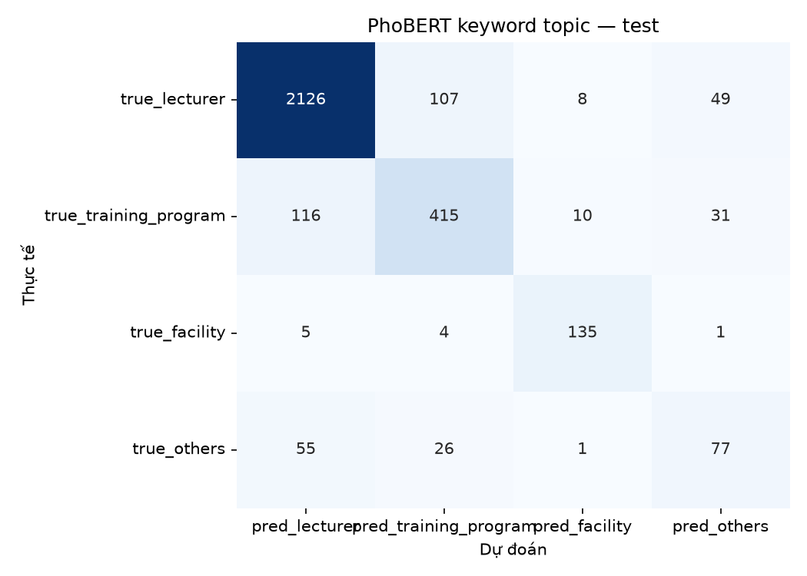
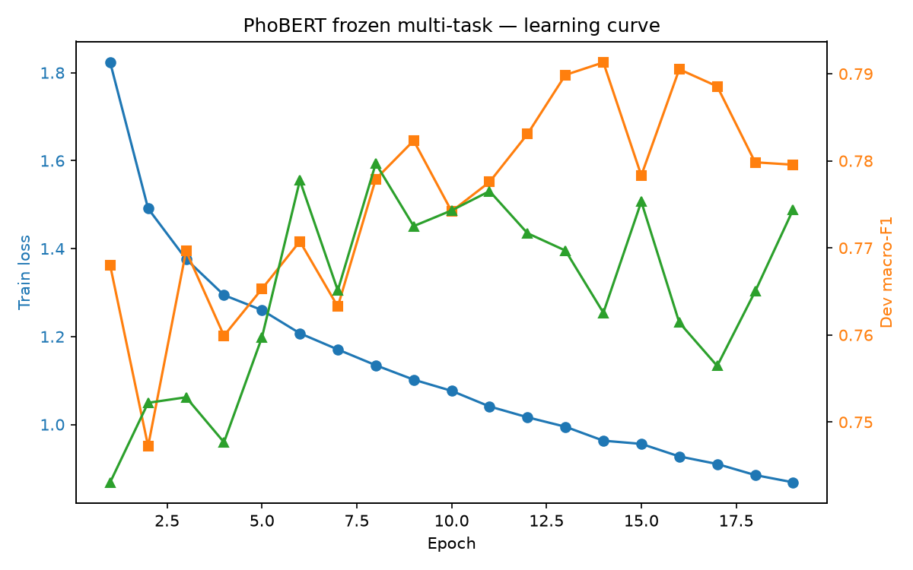

# PhoBERT keyword-aware multi-task — UIT-VSFC

- Run ID: `phobert_keyword_20261030_222651`
- Seed: `42`
- Encoder: `vinai/phobert-base` (frozen)
- Keyword features: `12`
- Keyword auxiliary loss weight: `0.5`
- Lambda topic: `1.0`
- Best epoch: `13`
- Train time: `22.0s`

## Kết quả

| task | split | accuracy | macro_f1 | weighted_f1 |
|---|---|---|---|---|
| sentiment | dev | 0.9248 | 0.7899 | 0.9229 |
| sentiment | test | 0.9141 | 0.7788 | 0.9124 |
| topic | dev | 0.8781 | 0.7697 | 0.8765 |
| topic | test | 0.8696 | 0.7633 | 0.8689 |
| joint | dev | 0.8187 |  |  |
| joint | test | 0.8054 |  |  |

## So sánh test macro-F1

| task | phobert_frozen_multitask | phobert_keyword_multitask | textcnn_multitask | textcnn_single | tfidf_logreg |
|---|---|---|---|---|---|
| sentiment | 0.7785 | 0.7788 | 0.7556 | 0.7621 | 0.74 |
| topic | 0.7428 | 0.7633 | 0.739 | 0.7355 | 0.7247 |

So với PhoBERT frozen cũ: sentiment gần như giữ nguyên (+0.0003), topic tăng **0.0205**, joint tăng **0.0199**.
So với TextCNN multi-task: sentiment tăng **0.0232**, topic tăng **0.0243**, joint tăng **0.0502**.

## sentiment — dev

| label | precision | recall | f1 | support |
|---|---|---|---|---|
| negative | 0.9285 | 0.9574 | 0.9427 | 705 |
| neutral | 0.5333 | 0.4384 | 0.4812 | 73 |
| positive | 0.951 | 0.9404 | 0.9457 | 805 |

## sentiment — test

| label | precision | recall | f1 | support |
|---|---|---|---|---|
| negative | 0.9262 | 0.9446 | 0.9353 | 1409 |
| neutral | 0.4966 | 0.4311 | 0.4615 | 167 |
| positive | 0.9413 | 0.9377 | 0.9395 | 1590 |

## topic — dev

| label | precision | recall | f1 | support |
|---|---|---|---|---|
| lecturer | 0.928 | 0.9409 | 0.9344 | 1151 |
| training_program | 0.7809 | 0.7341 | 0.7568 | 267 |
| facility | 0.8421 | 0.9143 | 0.8767 | 70 |
| others | 0.5281 | 0.4947 | 0.5109 | 95 |

## topic — test

| label | precision | recall | f1 | support |
|---|---|---|---|---|
| lecturer | 0.9235 | 0.9284 | 0.926 | 2290 |
| training_program | 0.7518 | 0.7255 | 0.7384 | 572 |
| facility | 0.8766 | 0.931 | 0.903 | 145 |
| others | 0.4873 | 0.4843 | 0.4858 | 159 |

## Learning curve

## Nhận xét

- Thêm 12 keyword features cho topic head: presence, density, last-3 presence.
- Có keyword auxiliary loss để buộc keyword head học tín hiệu chủ đề.
- Topic logits = base head + keyword head; sentiment head giữ nguyên.
