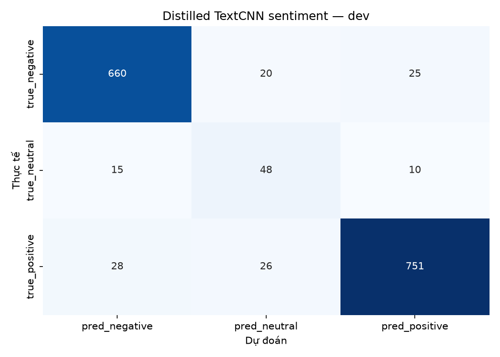
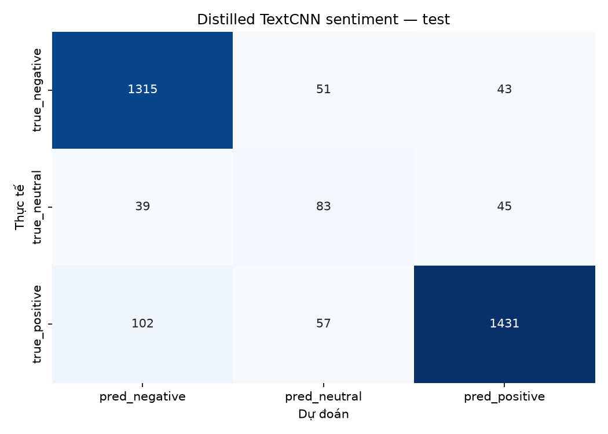
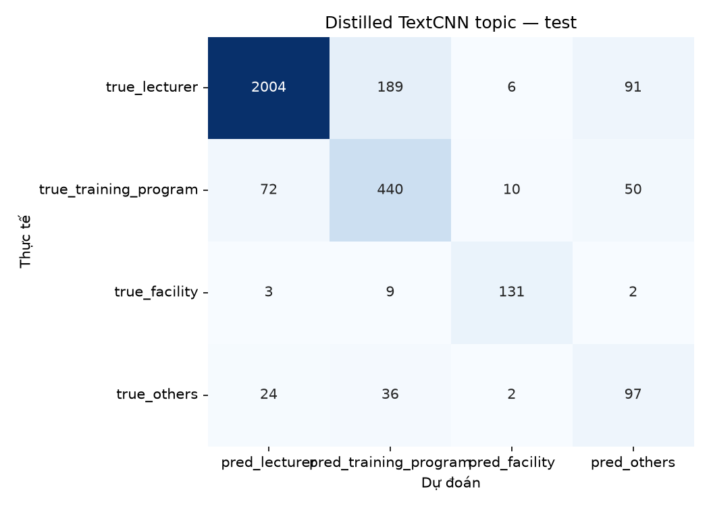
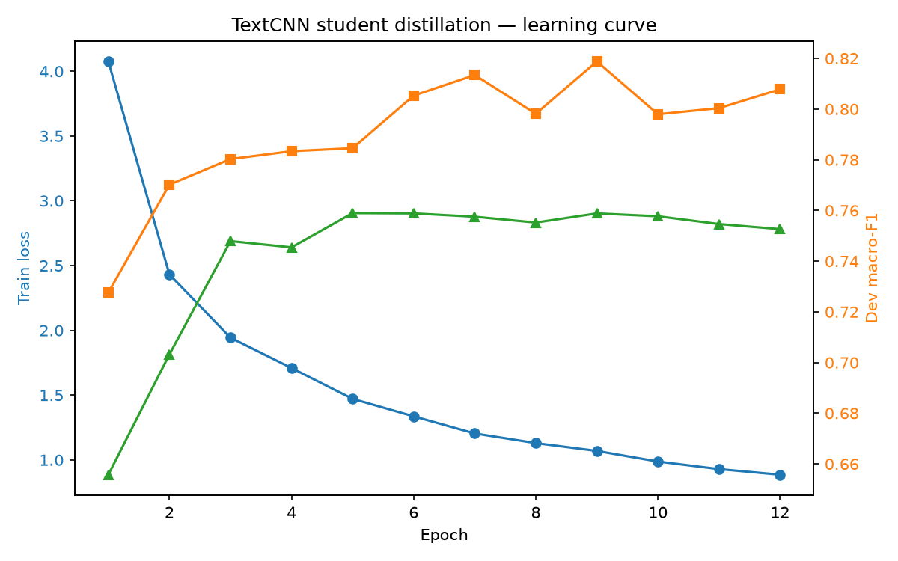

# TextCNN student distillation — UIT-VSFC

- Run ID: `textcnn_distill_20261031_124149`
- Seed: `42`
- Teacher: PhoBERT keyword-aware
- Student: TextCNN multi-task
- Temperature: `2.0`
- Distill weight: `0.5`
- Lambda topic: `1.0`
- Best epoch: `9`
- Train time: `87.9s`
- Student parameters: `407,055`
- Student size: `1.55 MB`

## Kết quả

| task | split | accuracy | macro_f1 | weighted_f1 |
|---|---|---|---|---|
| sentiment | dev | 0.9217 | 0.8188 | 0.9241 |
| sentiment | test | 0.8936 | 0.7674 | 0.8953 |
| topic | dev | 0.8604 | 0.7588 | 0.8662 |
| topic | test | 0.844 | 0.749 | 0.8528 |
| joint | dev | 0.8035 |  |  |
| joint | test | 0.7669 |  |  |

## So sánh test macro-F1

| task | phobert_keyword_multitask | textcnn_distilled | textcnn_multitask |
|---|---|---|---|
| sentiment | 0.7788 | 0.7674 | 0.7556 |
| topic | 0.7633 | 0.749 | 0.739 |

## sentiment — dev

| label | precision | recall | f1 | support |
|---|---|---|---|---|
| negative | 0.9388 | 0.9362 | 0.9375 | 705 |
| neutral | 0.5106 | 0.6575 | 0.5749 | 73 |
| positive | 0.9555 | 0.9329 | 0.9441 | 805 |

## sentiment — test

| label | precision | recall | f1 | support |
|---|---|---|---|---|
| negative | 0.9032 | 0.9333 | 0.918 | 1409 |
| neutral | 0.4346 | 0.497 | 0.4637 | 167 |
| positive | 0.9421 | 0.9 | 0.9206 | 1590 |

## topic — dev

| label | precision | recall | f1 | support |
|---|---|---|---|---|
| lecturer | 0.9538 | 0.8975 | 0.9248 | 1151 |
| training_program | 0.7047 | 0.7865 | 0.7434 | 267 |
| facility | 0.8205 | 0.9143 | 0.8649 | 70 |
| others | 0.4435 | 0.5789 | 0.5023 | 95 |

## topic — test

| label | precision | recall | f1 | support |
|---|---|---|---|---|
| lecturer | 0.9529 | 0.8751 | 0.9124 | 2290 |
| training_program | 0.6528 | 0.7692 | 0.7063 | 572 |
| facility | 0.8792 | 0.9034 | 0.8912 | 145 |
| others | 0.4042 | 0.6101 | 0.4862 | 159 |

## Learning curve

## Nhận xét

- Student học từ hard label + soft label của teacher.
- Mục tiêu là trade-off giữa F1 và chi phí suy luận, không nhất thiết vượt teacher.
- So sánh trực tiếp với TextCNN hard-label và PhoBERT teacher trong `reports/results.csv`.
