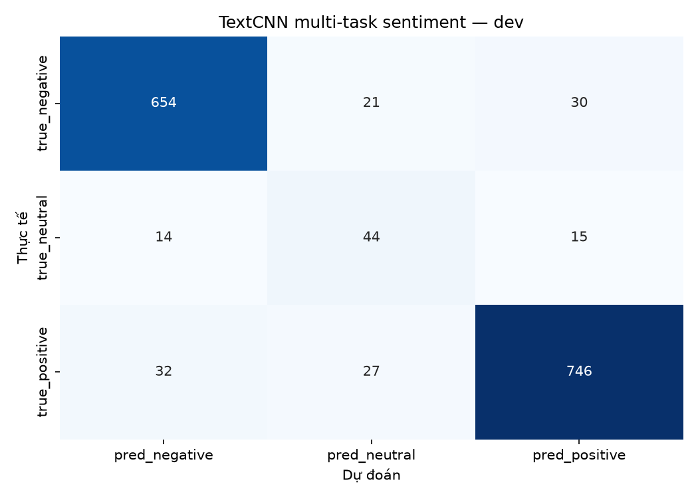
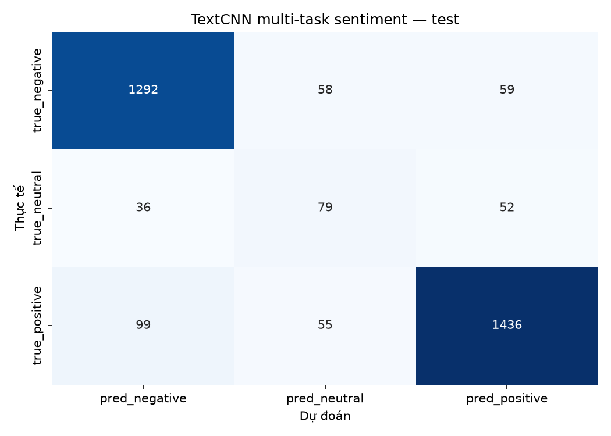
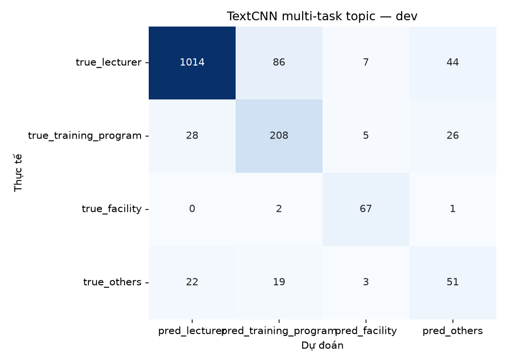
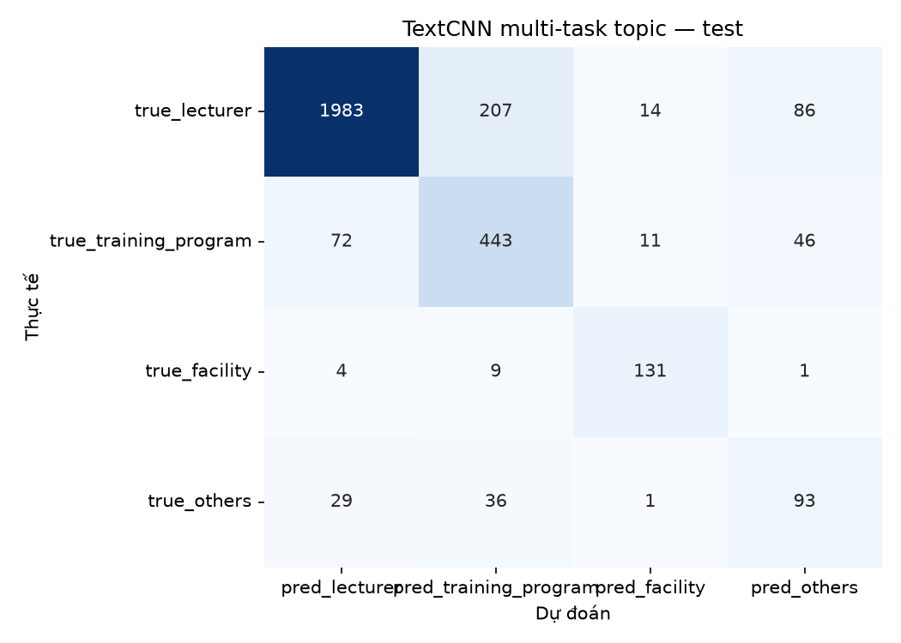
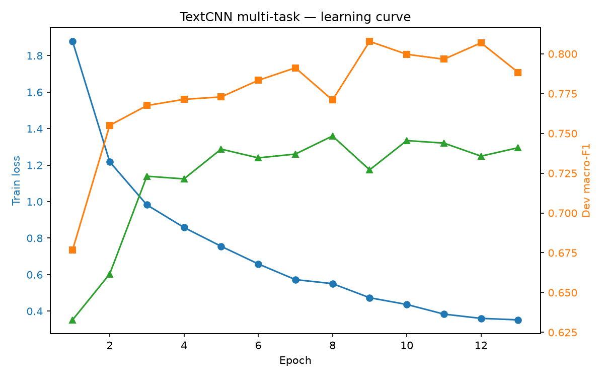

# TextCNN multi-task — UIT-VSFC

- Run ID: `textcnn_multitask_20261030_164537`
- Seed: `42`
- Lambda topic: `1.0`
- Max length: `48`
- Shared hidden: `256`
- Best epoch: `10`
- Train time: `93.6s`

## Kết quả

| task | split | accuracy | macro_f1 |
|---|---|---|---|
| sentiment | dev | 0.9122 | 0.7997 |
| sentiment | test | 0.8866 | 0.7556 |
| topic | dev | 0.8465 | 0.7455 |
| topic | test | 0.837 | 0.739 |
| joint | dev | 0.7858 |  |
| joint | test | 0.7552 |  |

## So sánh test macro-F1

| task | textcnn_multitask | textcnn_single | tfidf_logreg |
|---|---|---|---|
| sentiment | 0.7556 | 0.7621 | 0.74 |
| topic | 0.739 | 0.7355 | 0.7247 |

So với TextCNN single-task: sentiment giảm **0.0065**, topic tăng **0.0035**, joint tăng **0.0016**. Multi-task chưa cải thiện rõ rệt; `lambda=1.0` được chọn theo dev mean-F1, không dựa trên test.

## sentiment — dev

| label | precision | recall | f1 | support |
|---|---|---|---|---|
| negative | 0.9343 | 0.9277 | 0.931 | 705 |
| neutral | 0.4783 | 0.6027 | 0.5333 | 73 |
| positive | 0.9431 | 0.9267 | 0.9348 | 805 |

## sentiment — test

| label | precision | recall | f1 | support |
|---|---|---|---|---|
| negative | 0.9054 | 0.917 | 0.9111 | 1409 |
| neutral | 0.4115 | 0.4731 | 0.4401 | 167 |
| positive | 0.9282 | 0.9031 | 0.9155 | 1590 |

## topic — dev

| label | precision | recall | f1 | support |
|---|---|---|---|---|
| lecturer | 0.953 | 0.881 | 0.9156 | 1151 |
| training_program | 0.6603 | 0.779 | 0.7148 | 267 |
| facility | 0.8171 | 0.9571 | 0.8816 | 70 |
| others | 0.418 | 0.5368 | 0.47 | 95 |

## topic — test

| label | precision | recall | f1 | support |
|---|---|---|---|---|
| lecturer | 0.9497 | 0.8659 | 0.9059 | 2290 |
| training_program | 0.6374 | 0.7745 | 0.6993 | 572 |
| facility | 0.8344 | 0.9034 | 0.8675 | 145 |
| others | 0.4115 | 0.5849 | 0.4831 | 159 |

## Learning curve

## Nhận xét

- Multi-task dùng chung encoder, hai head riêng cho sentiment và topic.
- Loss: `L_sentiment + lambda * L_topic`.
- Chọn epoch tốt nhất theo trung bình macro-F1 của hai tác vụ trên dev.
- So sánh trực tiếp với TF-IDF và TextCNN single-task trong `reports/results.csv`.
