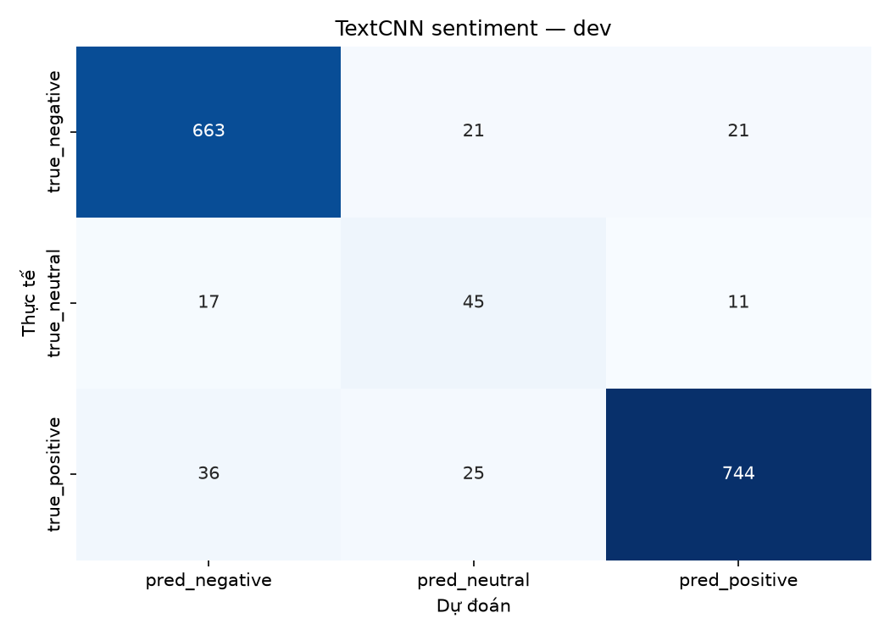
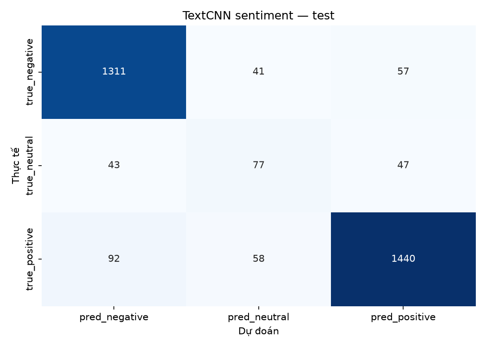
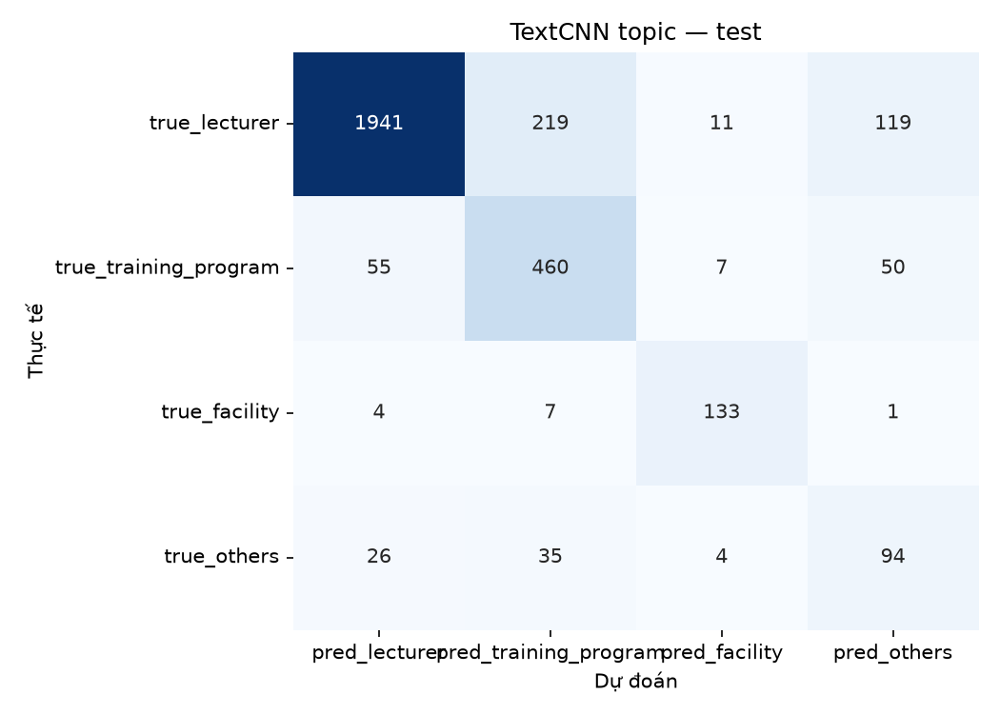
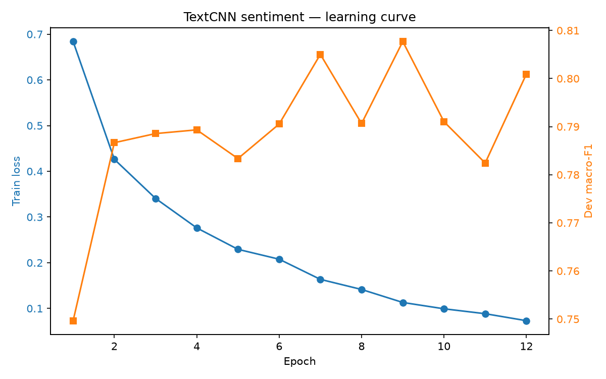
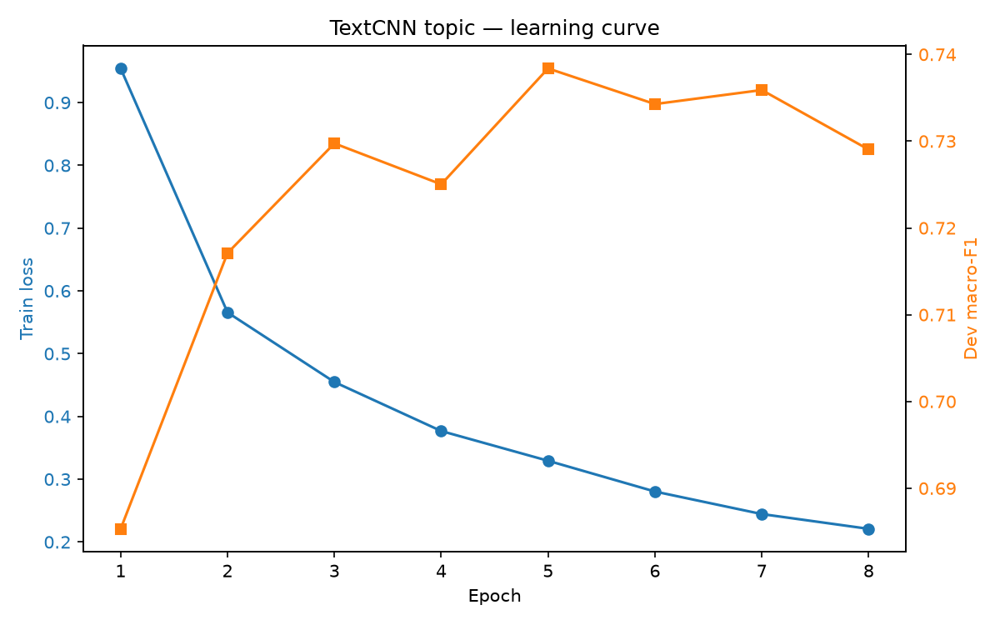

# TextCNN single-task — UIT-VSFC

- Run ID: `textcnn_single_20261030_163049`
- Seed: `42`
- Max length: `48`
- Embedding dim: `100`
- Filters per kernel: `100`
- Kernel sizes: `[3, 4, 5]`
- Dropout: `0.5`
- Batch size: `32`
- Learning rate: `0.001`

## Kết quả

| task | split | accuracy | macro_f1 | weighted_f1 | best_epoch | train_time_sec |
|---|---|---|---|---|---|---|
| sentiment | dev | 0.9172 | 0.8077 | 0.9195 | 9 | 76.7 |
| sentiment | test | 0.8932 | 0.7621 | 0.8939 | 9 | 76.7 |
| topic | dev | 0.8345 | 0.7384 | 0.8445 | 5 | 50.0 |
| topic | test | 0.8301 | 0.7355 | 0.8421 | 5 | 50.0 |

## Joint accuracy

| split | joint_accuracy |
|---|---|
| dev | 0.7738 |
| test | 0.7536 |

## sentiment — dev

| label | precision | recall | f1 | support |
|---|---|---|---|---|
| negative | 0.926 | 0.9404 | 0.9331 | 705 |
| neutral | 0.4945 | 0.6164 | 0.5488 | 73 |
| positive | 0.9588 | 0.9242 | 0.9412 | 805 |

## sentiment — test

| label | precision | recall | f1 | support |
|---|---|---|---|---|
| negative | 0.9066 | 0.9304 | 0.9184 | 1409 |
| neutral | 0.4375 | 0.4611 | 0.449 | 167 |
| positive | 0.9326 | 0.9057 | 0.919 | 1590 |

## topic — dev

| label | precision | recall | f1 | support |
|---|---|---|---|---|
| lecturer | 0.9609 | 0.854 | 0.9043 | 1151 |
| training_program | 0.6337 | 0.8165 | 0.7136 | 267 |
| facility | 0.7927 | 0.9286 | 0.8553 | 70 |
| others | 0.4104 | 0.5789 | 0.4803 | 95 |

## topic — test

| label | precision | recall | f1 | support |
|---|---|---|---|---|
| lecturer | 0.958 | 0.8476 | 0.8994 | 2290 |
| training_program | 0.638 | 0.8042 | 0.7115 | 572 |
| facility | 0.8581 | 0.9172 | 0.8867 | 145 |
| others | 0.3561 | 0.5912 | 0.4444 | 159 |

## Learning curve

## Nhận xét

- TextCNN dùng token tiếng Việt đã tách từ và vocabulary xây trên train.
- So sánh trực tiếp với baseline TF-IDF trong `reports/results.csv`.
- Chưa có multi-task; đây là mốc cho TextCNN multi-task.
